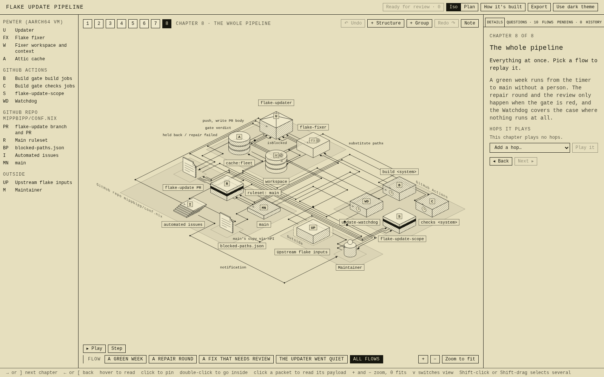

# axonometric

Interactive architecture maps you build with an AI agent. The agent writes a map of a system from its code and docs. You walk through it chapter by chapter, present it to your team as one diagram, and edit it in the browser. Your edits go back to the agent as proposals, which it accepts or argues against.

<p>
  <a href="https://www.npmjs.com/package/axonometric"></a>
  <a href="https://github.com/mippbipp/axonometric/blob/main/LICENSE"></a>
  <a href="https://skills.sh/mippbipp/axonometric"></a>
</p>



A map is one `data.mjs` file in your repo. The CLI places its structures, draws them, and serves the map as a page with an iso view and a plan view. It also writes `SYSTEM.md`, a text version for reading and diffing. The design is inspired by [inkboard/system-atlas](https://github.com/inkboard/system-atlas).

## Install

Install the CLI and the skill. The skill tells your agent when to use the CLI.

```sh
npm install -g axonometric
npx skills add mippbipp/axonometric
```

The npm package needs Node 24.22.1 or newer. Without Node, install a standalone binary, which has Node built in:

- **Linux and macOS:** `curl -fsSL https://github.com/mippbipp/axonometric/releases/latest/download/install.sh | sh` installs to `~/.local/bin`.
- **Windows, in PowerShell:** `irm https://github.com/mippbipp/axonometric/releases/latest/download/install.ps1 | iex` installs to `%LOCALAPPDATA%\Programs\axonometric`.
- **Nix:** `nix run github:mippbipp/axonometric -- --help`, or add `github:mippbipp/axonometric` as a flake input and install `packages.<system>.default`.

The install scripts check the binary against the release's `SHA256SUMS`. Set `AXONOMETRIC_VERSION` (for example `0.1.0`) to install another version, or `AXONOMETRIC_INSTALL_DIR` to install somewhere else.

## Quick start

Ask your agent to map a system:

```
Map how payments flow through this repo.
```

The agent reads the code, writes the map into `.scratch/payments/map/`, checks it, and starts the server:

```sh
axonometric serve .scratch/payments/map
```

Open the URL it prints, `http://127.0.0.1:5178` by default.

- **Walk through it.** Each chapter reveals a few structures. Press `]` for the next chapter and `[` to go back. Click a structure to pin its details, and double-click it to go inside.
- **Present it.** The last chapter shows the whole system. Pick a flow to play its packets. Switch between iso and plan with `v`.
- **Edit it.** Drag structures, rename them, add hops, answer questions or leave notes. Layout changes apply at once, and everything else becomes a proposal. Both show in the Pending tab until the agent reviews them.
- **Send it back.** Press "Ready for review". The page copies a prompt that starts "Use the axonometric skill to review batch N". Paste it to your agent. It accepts, changes or rejects each item with a reason, and the open page updates when it commits.

Maps go in `.scratch/<system>/`, which git ignores, or in `docs/<system>/` in repos that commit design docs. The agent asks which one if it can't tell.

## For AI agents

The guide an agent follows ships inside the CLI, so it matches the installed version and works offline:

```sh
axonometric docs           # the overview and the list of topics
axonometric docs process   # one topic
```

`axonometric docs <topic>` prints one: `process`, `data`, `chapters`, `design`, `review` and `visual-check`.

The skill from `npx skills add mippbipp/axonometric` is a short `SKILL.md` that sends the agent to `axonometric docs`. It triggers on requests to map, explain, review or present a system's architecture, and on the review prompt the page copies. Without the skill, add this to your `AGENTS.md`:

```markdown
Use `axonometric` for architecture maps. Before the first use, run
`axonometric docs` and follow it.
```

## Commands

Run `axonometric --help` for the full list, or `axonometric <command> --help` for one command.

| Group | Commands |
| --- | --- |
| Build a map | `init`, `build`, `check`, `layout` |
| Show it | `serve`, `status`, `export` |
| Review the engineer's edits | `review`, `verdict`, `commit` |
| Instructions | `docs` |

`export` writes an SVG or PNG of one view and chapter, or an Excalidraw file of the whole map.

## Platforms

Binaries exist for Linux x64 and arm64 (glibc only), macOS x64 and arm64, and Windows x64.

The macOS binaries have an ad-hoc signature and aren't notarized. If you download a macOS archive in a browser, macOS quarantines the binary and refuses to open it. Clear that with `xattr -d com.apple.quarantine <path to axonometric>`. The install script downloads with curl, which doesn't set the quarantine. The Windows binary isn't signed, so SmartScreen may warn the first time you run it.

## Contributing

[CONTRIBUTING.md](CONTRIBUTING.md) covers the dev shell, tests and the agent guide. [GLOSSARY.md](GLOSSARY.md) defines the terms the code and docs use.

## License

MIT
